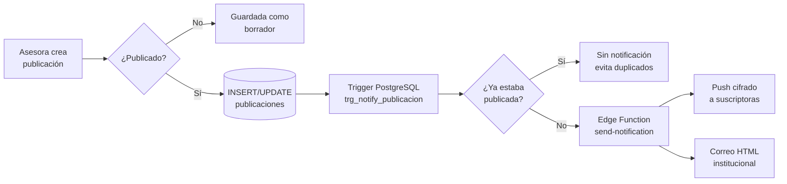

<div align="center">


# IMMUJEL — Plataforma Web Institucional

### Instituto Municipal de la Mujer de Lagunillas
**Ciudad Ojeda, Estado Zulia — Venezuela**

Aplicación Web Progresiva (PWA) para la atención integral, asesoría jurídica, psicológica y social de la mujer lagunillense.

<br>

[](https://immujel.vercel.app)
[](https://immujel.vercel.app)
[](#-licencia-y-uso)

<br>


</div>

---

## Tabla de contenido

- [Sobre el proyecto](#-sobre-el-proyecto)
- [Acceso rápido](#-acceso-rápido)
- [Funcionalidades](#-funcionalidades)
- [Roles y permisos](#-roles-y-permisos)
- [Arquitectura](#-arquitectura)
- [Estructura del repositorio](#-estructura-del-repositorio)
- [Instalación local](#-instalación-local)
- [Configuración de Supabase](#-configuración-de-supabase)
- [Despliegue](#-despliegue)
- [Documentación](#-documentación)
- [Contacto](#-contacto)

---

## 📖 Sobre el proyecto

IMMUJEL es una institución municipal que brinda acompañamiento **gratuito y confidencial** a mujeres en situación de vulnerabilidad. Esta plataforma digitaliza tres procesos que antes eran exclusivamente presenciales:

| Antes | Ahora |
|:---|:---|
| Solicitud de asesoría solo en sede física | Formulario en línea 24/7, con **modo incógnito** para casos sensibles |
| Difusión de actividades por redes sociales dispersas | **Semanario Institucional** y **Noticiero** centralizados y buscables |
| Seguimiento de casos en papel | **Panel de administración** con estados, asignaciones y notas internas |

La aplicación es una **PWA instalable**: funciona en computadora, tablet y celular, se puede agregar a la pantalla de inicio y envía notificaciones push cuando se publica contenido nuevo.

### Principios institucionales

<div align="center">

| ⚖️ Gratuidad | 🔒 Confidencialidad | ♀️ Equidad |
|:---:|:---:|:---:|
| Todos los servicios sin costo | Atención completamente privada | Con perspectiva de género |

</div>

---

## 🔗 Acceso rápido

<div align="center">

| Recurso | Enlace |
|:---|:---|
| **Sitio en producción** | [immujel.vercel.app](https://immujel.vercel.app) |
| **Espejo GitHub Pages** | [jdbr0505.github.io/IMMUJEL](https://jdbr0505.github.io/IMMUJEL/) |
| **Solicitar asesoría** | [Formulario en línea](https://immujel.vercel.app/Forms/form.html) |
| **Semanario Institucional** | [Ver ediciones](https://immujel.vercel.app/navegacion/semanario.html) |
| **Noticiero** | [Ver noticias](https://immujel.vercel.app/navegacion/noticiero.html) |

<br>

**Acceso desde el celular**


*Escanea para abrir el sitio e instalarlo como aplicación*

</div>

---

## ✨ Funcionalidades

### Para las usuarias

<table>
<tr>
<td width="50%" valign="top">

**🔐 Cuentas y acceso**
- Registro con confirmación por correo
- Inicio de sesión con usuario o correo
- Recuperación de contraseña por enlace
- Cierre de sesión seguro

</td>
<td width="50%" valign="top">

**📝 Solicitudes de asesoría**
- Formulario en línea con validación
- **Modo incógnito** — solo teléfono y descripción
- Selección de parroquia y tipo de asesoría
- Confirmación inmediata de envío
- **Sin conexión**: la solicitud queda guardada en el dispositivo y se envía sola al volver la red

</td>
</tr>
<tr>
<td width="50%" valign="top">

**📰 Contenido institucional**
- Semanario Institucional con buscador
- Noticiero de anuncios puntuales
- Publicaciones con imágenes y documentos PDF
- Vista individual de cada publicación

</td>
<td width="50%" valign="top">

**🔔 Notificaciones y PWA**
- Notificaciones push al publicar contenido
- Correo institucional con cada publicación
- Instalable en pantalla de inicio
- Modo oscuro y lectura sin conexión de lo ya visitado

</td>
</tr>
</table>

### Para el personal — Panel de Administración

<table>
<tr>
<td width="50%" valign="top">

**📊 Pestaña Asesorías**
- Indicadores (KPI): Total · Pendientes · En Proceso · Finalizados · Sin asignar
- Filtros por parroquia, estado y asignación (sin asignar, asignadas a mí)
- Detalle completo de cada solicitud
- Notas internas por caso
- Asignación de casos: todos llegan primero a la abogada institucional, que es la única que asigna (hasta dos personas por caso: responsable y apoyo), con historial
- Registro manual de asesorías presenciales

</td>
<td width="50%" valign="top">

**📄 Pestaña CMS**
- Editor de texto enriquecido
- Carga de imágenes y PDF a Supabase Storage
- Estados: publicado / borrador
- Acciones masivas: publicar, ocultar, eliminar
- Búsqueda y filtros por tipo
- Autoguardado de borradores
- Atajos: `Ctrl+S` guardar · `Esc` cerrar

</td>
</tr>
<tr>
<td colspan="2" valign="top">

**👥 Pestaña Usuarias** *(exclusiva para Administradoras)*
Listado de todo el personal registrado, búsqueda por nombre/usuario/correo, filtro por rol y cambio de rol con confirmación.
Debajo, la tabla **Personal de asesorías**: la administradora agrega (nombre de una cuenta registrada + cargo), retira y reincorpora a la abogada institucional, la abogada comunal, las psicólogas y las defensoras, y ve cuántos casos abiertos lleva cada una.

</td>
</tr>
</table>

---

## 👤 Roles y permisos

| Rol | Solicitar asesoría | Ver publicaciones | Gestionar solicitudes | Publicar contenido | Administrar roles |
|:---|:---:|:---:|:---:|:---:|:---:|
| **Usuaria** | ✅ | ✅ | ❌ | ❌ | ❌ |
| **Asesora** | ✅ | ✅ | ✅ | ✅ | ❌ |
| **Admin** | ✅ | ✅ | ✅ | ✅ | ✅ |

> Los permisos se aplican en dos capas: la interfaz oculta las opciones no autorizadas, y las **políticas de Row Level Security (RLS)** de PostgreSQL las bloquean a nivel de base de datos.

### Personal de asesorías y asignación de casos

Aparte del rol de la cuenta, el personal que atiende los casos tiene un **cargo**. Los casos llegan primero a la abogada institucional (Dahize Barrada), que decide quién los atiende.

| Cargo | Función | Quién lo agrega o retira |
|:---|:---|:---|
| **Abogada institucional** | Recibe todos los casos y es la **única** que los asigna. Solo hay una activa a la vez | Administradora |
| **Abogada comunal** | Da seguimiento a los órganos receptores de denuncias | Administradora |
| **Psicóloga** | Acompañamiento psicológico | Administradora |
| **Defensora** | Cubre el seguimiento cuando la abogada comunal no puede | Administradora |

- Un caso lleva **una o dos personas**: responsable y apoyo. Reasignar libera a la anterior y queda en el historial del caso.
- Para figurar en el personal hay que **tener cuenta en IMMUJEL**; la administradora la elige por nombre desde Usuarias → Personal de asesorías.
- La abogada institucional necesita rol **Asesora** (o Admin) para entrar al panel; el panel ofrece dárselo al agregarla.
- Retirar a alguien no borra nada: sus casos siguen a su nombre hasta que la abogada institucional los reasigne (vuelven a «Sin asignar»).
- Las reglas las hace cumplir la base de datos (`supabase-sql/setup_asignacion_casos.sql`), no solo la pantalla: ni la administradora puede asignar casos si no es la abogada institucional, y tampoco se pueden escribir a mano las columnas `asignada_a` y `asignada_por` de `solicitudes`.
- La administradora decide qué cuenta es la abogada institucional (el panel pide confirmar nombre y correo); conviene cuidar que solo ella tenga rol Admin.

---

## 🏗 Arquitectura

```
┌──────────────────────────────────────────────────────────────┐
│  NAVEGADOR (PWA)                                             │
│  HTML · Tailwind CSS · JavaScript · Service Worker           │
└───────────────┬──────────────────────────────┬───────────────┘
                │                              │
    ┌───────────▼──────────┐      ┌────────────▼─────────────┐
    │  VERCEL              │      │  SUPABASE                │
    │  ─────────────────   │      │  ──────────────────────  │
    │  Hosting estático    │      │  PostgreSQL + RLS        │
    │  /api/config.js      │─────▶│  Auth (3 roles)          │
    │  Cabeceras seguridad │      │  Storage (imágenes/PDF)  │
    └──────────────────────┘      │  Edge Functions (Deno)   │
                                  └────────────┬─────────────┘
                                               │
                          ┌────────────────────▼───────────────────┐
                          │  send-notification (Edge Function)     │
                          │  ─────────────────────────────────────  │
                          │  · Web Push RFC 8291 (aes128gcm)       │
                          │  · VAPID JWT RFC 8292 (ES256)          │
                          │  · Correo HTML vía SMTP                │
                          └────────────────────────────────────────┘
```

### Flujo de una publicación



### Decisiones técnicas

| Decisión | Motivo |
|:---|:---|
| **Sin framework JS** | El sitio debe cargar rápido en conexiones lentas y equipos modestos. HTML y JavaScript nativo eliminan el peso de un runtime de framework. |
| **Supabase como backend** | Autenticación, base de datos, almacenamiento y funciones en un solo servicio gestionado, sin necesidad de mantener un servidor propio. |
| **Web Push nativo** | Implementación directa de RFC 8291/8292 en la Edge Function, sin dependencias de terceros ni servicios de pago. |
| **RLS en PostgreSQL** | La autorización vive en la base de datos, no solo en el cliente — un usuario no puede saltarse los permisos manipulando el navegador. |
| **Claves vía `/api/config.js`** | Las credenciales de Supabase se sirven desde una función de Vercel con saneamiento, en lugar de estar embebidas en el HTML. |
| **Cola de solicitudes en IndexedDB** | Una solicitud de asesoría no se pierde si la red cae al enviarla: se guarda en el dispositivo y se reintenta sola (ver [Modo sin conexión](#modo-sin-conexión)). |

### Modo sin conexión

El Service Worker (`sw.js`) reparte cada petición según su tipo; las reglas son funciones puras en `js/offline-core.js`, con pruebas en `tests/`.

| Qué se pide | Estrategia |
|:---|:---|
| Páginas | Red primero (4 s de espera), luego la copia guardada, luego `/offline`. |
| Archivos propios con `?v=` | Caché primero: la versión cambia cuando cambia el archivo. |
| Archivos propios sin versión y bibliotecas externas | Se sirve la copia y se renueva en segundo plano. |
| `/api/config` | Red primero, con copia guardada al instalar (sin ella Supabase no inicia sin conexión). |
| Imágenes externas | Caché primero, máximo 80. |
| Lecturas públicas de Supabase (`publicaciones`, `configuracion_visual`) | Red primero; si falla, la última copia, separada por cuenta. |
| Escrituras, autenticación, `rpc`, otras tablas | Nunca se interceptan. |

**Precarga.** `sw-precache.js` lo genera `scripts/generar-precache.js`: lee las páginas públicas y lista sus archivos tal como los piden (con `?v=`). Su versión sale del contenido, así que al cambiar cualquier página o archivo cambia la versión y el Service Worker descarta la caché anterior.

> **Después de editar una página, un script o una hoja de estilos referenciados, ejecuta `node scripts/generar-precache.js`.** `node --test tests/*.test.js` falla si el archivo quedó desactualizado.

**Solicitudes sin conexión.** `Forms/form.js` guarda la solicitud con `js/offline-db.js` cuando no hay red o el servidor falla (5xx, 408, 429). Se envía sola: por el evento `sync` del Service Worker donde existe (Chromium) y, en cualquier navegador, al volver la conexión, al volver a la pestaña o al abrir una página. Si el servidor está ocupado (5xx, 408, 429) reintenta con esperas crecientes (1 min a 12 h); sin red no alarga la espera y lo intenta de nuevo en cuanto vuelve la conexión; el botón "Enviar ahora" ignora la espera. No reintenta lo que el servidor rechaza (4xx: queda marcado como fallido para que la usuaria lo reintente o lo descarte). A los 3 días sin enviarse borra los datos personales y deja una marca ("venció sin enviarse") que se avisa en todas las páginas hasta que la usuaria la cierre. Un reclamo atómico evita que dos pestañas envíen lo mismo, y descartar una solicitud mientras se envía no la hace reaparecer.

**Privacidad.** Los datos personales de una solicitud pendiente viven solo en IndexedDB del dispositivo hasta enviarse, descartarse o vencer; la usuaria puede descartarla en el aviso de la página. El Service Worker no muestra notificaciones por estos envíos (el texto podría verse en la pantalla bloqueada). Si un envío falla de forma ambigua (la respuesta se pierde, pero el servidor sí la recibió), el reenvío no crea una segunda solicitud: cada una nace con un `client_id` al azar (sin datos personales) y un trigger de la base descarta en silencio la que repite uno ya recibido (ver el paso 4b de Supabase; no se usa `ON CONFLICT` porque exigiría darle permiso de lectura al público).

---

## 📁 Estructura del repositorio

```
IMMUJEL/
│
├── index.html                    Página principal
├── ds.css                        Diseño compartido de las páginas públicas: cabecera de página, hojas, botones, tarjetas y pie (usa los tokens de tema)
├── nav.css                       Encabezado común de todas las páginas: una sola fila en escritorio, panel desplegable en móvil (usa los tokens de tema)
├── home.css                      Estilos propios de la página principal (usa los tokens de tema)
├── styles.css                    Identidad visual y tema oscuro
├── sw.js                         Service Worker: estrategias de caché por tipo de petición, sincronización en segundo plano y push
├── sw-precache.js                Lista de lo que se guarda al instalar (GENERADO con scripts/generar-precache.js; no se edita a mano)
├── offline.html                  Página que se muestra sin conexión cuando no hay copia de la que se pide
├── manifest.json                 Manifiesto PWA
├── vercel.json                   Cabeceras de seguridad y caché
│
├── js/                           Scripts compartidos por todo el sitio
│   ├── auth.js                   Sesión, roles y botones del encabezado (Admin, notificaciones, ingreso)
│   ├── animations.js             Animaciones de scroll
│   ├── cookies.js                Consentimiento de cookies (banner + utilidades)
│   ├── historial.js              Historial local de publicaciones vistas
│   ├── home.js                   Página principal: carrusel de láminas, contadores y aparición (lógica probada en tests/)
│   ├── sw-register.js            Registro del Service Worker (las versiones nuevas se activan solas)
│   ├── offline-core.js           Reglas del modo sin conexión: clasificación de peticiones y cola de envío (puras, probadas en tests/)
│   ├── offline-db.js             Cola de solicitudes y configuración en IndexedDB; envío a Supabase (lo usan la página y el Service Worker)
│   ├── offline-ui.js             Aviso de conexión y de solicitudes pendientes, con Enviar ahora, Reintentar y Descartar
│   └── ui.js                     Menú móvil, desplegable de Servicios y modo oscuro
│
├── Login/                        Autenticación
│   ├── login.html · login.js · login-styles.css
│   ├── signup.html · signup.js · signup-styles.css
│   ├── errores-auth.js           Mensajes de error de Supabase Auth en español (puros, probados en tests/)
│   ├── confirmado.html · confirmado.js   Pantalla a la que lleva el botón del correo de confirmación (confirmado, vencido, error)
│   ├── estado-enlace.js          Decide la pantalla según el enlace del correo (puro, probado en tests/)
│   ├── update-password.html
│   ├── email-confirmacion.html   Correo de confirmación de cuenta (se pega en Supabase, ver el paso 7)
│   ├── reset-password-email.html Correo de restablecer contraseña (se pega en Supabase, ver el paso 7)
│   └── Login_supabase.js         Cliente Supabase compartido
│
├── Forms/                        Solicitudes de asesoría
│   ├── form.html
│   ├── form.js                   Validación, modo incógnito y guardado sin conexión
│   └── form-styles.css
│
├── navegacion/                   Secciones públicas del sitio
│   ├── semanario.html            Semanario Institucional
│   ├── noticiero.html            Noticiero
│   ├── publicacion.html          Vista individual
│   ├── Programas.html            Talleres y formación
│   ├── Sobre Nosotras.html       Información institucional
│   ├── FL.html                   Fundamentos legales
│   └── privacidad.html           Política de privacidad y cookies
│
├── Admin/                        Panel de administración
│   ├── Admin.html
│   ├── Admin.js                  Asesorías + gestión de usuarias
│   ├── asignacion.js             Reglas de la asignación de casos y del personal (puras, probadas en tests/)
│   ├── Admin_asignacion.js       Personal de asesorías (Usuarias) y asignación de casos (Asesorías)
│   ├── Admin_cms.js              CMS de publicaciones
│   ├── admin-styles.css
│   ├── Dashboard.html            Dashboard: asesorías, usuarias (solo admin) y publicaciones, sin datos personales
│   ├── dashboard.js              Carga de datos, periodo, actualización en vivo, CSV e impresión
│   ├── dashboard-metrics.js      Cálculos puros (probados en tests/)
│   ├── dashboard-export.js       Exportación a CSV de los totales
│   ├── dashboard-charts.js       Gráficos Chart.js y sparkline
│   ├── dashboard-ui.js           Utilidades de interfaz compartidas
│   ├── dashboard-render.js       Sección de asesorías
│   ├── dashboard-render-extra.js Secciones de usuarias y publicaciones
│   └── dashboard.css
│
├── api/
│   └── config.js                 Entrega saneada de credenciales
│
├── supabase/functions/
│   └── send-notification/
│       └── index.ts              Web Push + correo (Deno)
│
├── supabase-sql/                 Migraciones y políticas
│   ├── TODO_EN_UNO.sql           Esquema completo
│   ├── setup_notificaciones.sql
│   ├── setup_push_subscriptions.sql
│   ├── add_finalizado_en.sql     Opcional: registra el cierre de cada solicitud (tiempo de resolución del dashboard)
│   ├── add_client_id_solicitudes.sql  Evita solicitudes duplicadas al reenviar una guardada sin conexión (columna client_id + trigger; paso 4b)
│   ├── setup_asignacion_casos.sql  Personal de asesorías, asignación de casos y sus reglas (RLS + función)
│   ├── proteger_rol_perfiles.sql   Cada cuenta edita solo su perfil y solo una administradora da o cambia roles
│   ├── proteger_solicitudes.sql    Solo el personal del panel ve y edita solicitudes, notas y perfiles
│   └── alter_storage_rls.sql
│
├── scripts/                      Utilidades de mantenimiento
│   └── generar-precache.js       Escribe sw-precache.js (node scripts/generar-precache.js)
│
├── tests/                        Pruebas con el ejecutor de Node: node --test tests/*.test.js
│
├── docs/                         Manual de uso y material de capacitación
│
└── Images/                       Logo, QR y recursos visuales
```

---

## 🚀 Instalación local

### Requisitos

- Navegador moderno (Chrome, Edge, Firefox o Safari)
- [Node.js 18+](https://nodejs.org) *(opcional, solo para el servidor local)*
- Una cuenta de [Supabase](https://supabase.com) *(solo si vas a modificar el backend)*

### Pasos

```bash
git clone https://github.com/jdbr0505/IMMUJEL.git
cd IMMUJEL
```

El proyecto es HTML estático, así que basta con servirlo desde cualquier servidor local:

```bash
npx serve .
```

Luego abre `http://localhost:3000` en el navegador.

> **Nota:** El Service Worker y las notificaciones push requieren `https://` o `localhost`. No funcionan si abres el archivo directamente con `file://`.

### Variables de entorno

Crea un archivo `.env.local` en la raíz:

```env
SUPABASE_URL=https://tu-proyecto.supabase.co
SUPABASE_ANON_KEY=tu_clave_anonima
```

Estas variables se configuran también en el panel de Vercel para el despliegue en producción.

Para la Edge Function de notificaciones, define en Supabase:

```env
MY_SUPABASE_URL=https://tu-proyecto.supabase.co
MY_SUPABASE_KEY=tu_service_role_key
SMTP_USER=correo@institucional.com
SMTP_PASS=contraseña_de_aplicación
VAPID_PUBLIC_KEY=clave_pública_vapid
VAPID_PRIVATE_KEY=clave_privada_vapid
```

> ⚠️ **Nunca subas archivos `.env` al repositorio.** Ya están excluidos en `.gitignore`.

---

## 🗄 Configuración de Supabase

### 1. Crear el esquema

Ejecuta el script completo desde el **SQL Editor** de Supabase:

```
supabase-sql/TODO_EN_UNO.sql
```

Esto crea las tablas principales:

| Tabla | Propósito |
|:---|:---|
| `perfiles` | Datos y rol de cada cuenta registrada |
| `solicitudes` | Solicitudes de asesoría (web y manuales) |
| `notas_solicitud` | Notas internas del equipo por caso |
| `publicaciones` | Semanario y Noticiero |
| `push_subscriptions` | Suscripciones a notificaciones push |

### 2. Configurar notificaciones

```
supabase-sql/setup_notificaciones.sql
supabase-sql/setup_push_subscriptions.sql
```

### 3. Permisos de Storage

```
supabase-sql/alter_storage_rls.sql
```

Crea dos buckets públicos: `publicacion-imagenes` y `publicacion-pdfs`.

### 4. Asignación de casos y personal de asesorías

Ejecuta, en este orden, desde el **SQL Editor** (los tres se pueden repetir sin problema):

```
supabase-sql/setup_asignacion_casos.sql
supabase-sql/proteger_rol_perfiles.sql
supabase-sql/proteger_solicitudes.sql
```

| Tabla / función | Propósito |
|:---|:---|
| `personal_asesoria` | Quién forma parte del personal y con qué cargo (se retira desactivando, no borrando) |
| `asignaciones_caso` | Quién tuvo cada caso y cuándo (máximo dos vigentes por caso) |
| `asignar_caso()` | Única vía para asignar: exige ser la abogada institucional activa y tener acceso al panel |

Los dos últimos scripts cierran huecos de `TODO_EN_UNO.sql`, cuyas políticas solo piden «tener sesión»:

- `proteger_rol_perfiles.sql`: la política `perfiles_update_auth` dejaba que cualquier cuenta cambiara cualquier fila de `perfiles` (su propio `rol` y hasta el `id` para suplantar a otra). Con él, cada cuenta edita solo su perfil y solo una administradora da o cambia roles.
- `proteger_solicitudes.sql`: cualquier persona registrada podía leer por la API la cédula, el teléfono y la descripción de **todas** las solicitudes, las notas internas y los datos de todas las cuentas. Con él, solo el personal del panel (admin y asesoras) las ve y las edita; el formulario público sigue creando solicitudes.

Después de ejecutarlos: Usuarias → Personal de asesorías → agrega a la abogada institucional.

### 4b. Evitar solicitudes duplicadas al reenviar

Ejecuta **antes de subir** la versión del formulario que envía `client_id` (se puede repetir sin problema):

```
supabase-sql/add_client_id_solicitudes.sql
```

Agrega `solicitudes.client_id` (UUID, índice único) y un trigger que descarta en silencio un envío cuyo `client_id` ya existe. Sin este script el formulario público falla, porque la columna no existe. Las solicitudes anteriores y las que crea el panel quedan sin `client_id` y no cambian.

### 5. Generar claves VAPID

```bash
npx web-push generate-vapid-keys
```

Guarda el par de claves en las variables de entorno de la Edge Function.

### 6. Desplegar la Edge Function

```bash
supabase functions deploy send-notification
```

### 7. Correos de confirmación de cuenta y de restablecer contraseña

Los correos que reciben las usuarias salen de `Login/email-confirmacion.html` (al registrarse) y `Login/reset-password-email.html` (al olvidar la contraseña). Supabase no los lee del repositorio: hay que pegarlos a mano cada vez que cambien.

| Correo | Pestaña en **Authentication → Emails** | Asunto (**Subject heading**) | Archivo |
|:---|:---|:---|:---|
| Confirmación de cuenta | Confirm sign up | `Registro exitoso: activa tu cuenta en IMMUJEL` | `Login/email-confirmacion.html` |
| Restablecer contraseña | Reset password | `Restablece tu contraseña de IMMUJEL` | `Login/reset-password-email.html` |

En **Message body**, pestaña **Source**, reemplaza todo por el contenido del archivo y pulsa **Save changes**.

**A dónde lleva el botón del correo.** Al registrarse, `signup.js` pide que el botón lleve a `/Login/confirmado`, la pantalla «Registro confirmado». Supabase solo redirige a direcciones permitidas: en **Authentication → URL Configuration** pon *Site URL* `https://immujel.vercel.app` y, en *Redirect URLs*, `https://immujel.vercel.app/**` (cubre también `/Login/update-password.html` del correo de restablecer). Si la dirección no estuviera permitida, Supabase manda a la usuaria a la raíz del sitio y `js/auth.js` la reenvía a la pantalla de confirmación.

**Nombre del remitente.** Con el servicio de correo integrado de Supabase los mensajes salen como «Supabase Auth» y con límites muy bajos de envío. Para que salgan como «IMMUJEL», en **Authentication → Emails → SMTP Settings** activa *Enable custom SMTP* y completa: *Sender email* (la cuenta de Gmail institucional), *Sender name* `IMMUJEL`, *Host* `smtp.gmail.com`, *Port* `465`, *Username* (esa misma cuenta) y *Password* (contraseña de aplicación de Google). Son los mismos datos que `SMTP_USER` y `SMTP_PASS` de la Edge Function.

Las plantillas usan solo variables de Supabase (`{{ .ConfirmationURL }}` y `{{ .Email }}`), el logotipo del bucket público `publicacion-imagenes` de Storage (así también se ve en la vista previa del panel de Supabase) y el formato que aceptan los clientes de correo (tablas y estilos en línea). Siguen los colores y los textos de la página principal; si se cambia el logotipo o el dominio, hay que actualizar en ambas las direcciones de la imagen y de los enlaces. Muchos clientes (Outlook, Hotmail) ocultan las imágenes remotas hasta que la usuaria pulsa «mostrar imágenes»; mientras tanto se ve el texto «IMMUJEL» en su lugar.

---

## 🌐 Despliegue

El proyecto se despliega automáticamente en **Vercel** con cada `push` a la rama `main`.

```bash
git add .
git commit -m "feat: descripción del cambio"
git push origin main
```

### Configuración en Vercel

| Ajuste | Valor |
|:---|:---|
| Framework Preset | *Other* |
| Build Command | *(ninguno)* |
| Output Directory | `.` |
| Variables de entorno | `SUPABASE_URL`, `SUPABASE_ANON_KEY` |

Las cabeceras de seguridad (`X-Frame-Options`, `X-Content-Type-Options`, `Referrer-Policy`, `Permissions-Policy`) y las reglas de caché se definen en [`vercel.json`](vercel.json).

> **Importante:** La Edge Function vive en Supabase, no en Vercel. Al modificar `supabase/functions/send-notification/index.ts` debes desplegarla por separado con `supabase functions deploy send-notification`.

---

## 📚 Documentación

| Documento | Descripción |
|:---|:---|
| [**Manual de Uso**](docs/Manual%20de%20Uso%20-%20IMMUJEL.docx) | Guía paso a paso para asesoras y personal, en lenguaje sencillo y sin tecnicismos |
| [**Diapositivas del Taller**](docs/Diapositivas%20-%20Taller%20IMMUJEL.pptx) | Material de capacitación para el personal de IMMUJEL |
| [**Política de Privacidad**](navegacion/privacidad.html) | Qué datos recopilamos, cookies y derechos de las usuarias |

El manual cubre el registro de cuentas, el envío de solicitudes, la activación de notificaciones y el uso completo del panel de administración, además de una sección de preguntas frecuentes y un glosario de términos.

### Convenciones de commits

El repositorio sigue [Conventional Commits](https://www.conventionalcommits.org/es/):

```
feat:     nueva funcionalidad
fix:      corrección de error
refactor: reestructuración sin cambio de comportamiento
docs:     documentación
style:    formato, sin cambio de lógica
chore:    mantenimiento
```

---

## 📄 Licencia y uso

Este proyecto fue desarrollado como **Trabajo Especial de Grado** para la Universidad Dr. José Gregorio Hernández (UNIOJEDA), en colaboración con el Instituto Municipal de la Mujer de Lagunillas.

El código está disponible con fines **académicos y de referencia**. La identidad visual, el logotipo y los contenidos institucionales son propiedad de IMMUJEL y no pueden reutilizarse sin autorización.

---

## 📬 Contacto

<div align="center">

**Instituto Municipal de la Mujer de Lagunillas**

Calle Vargas, esquina Calle Piar, Casa N.° 218
Ciudad Ojeda, Estado Zulia — Venezuela

📧 immujel2024@hotmail.com
📞 [+58 424-654-0241](tel:+584246540241)

<br>

[](https://www.instagram.com/immujellags_/)
[](https://api.whatsapp.com/send?phone=584246540241)
[](https://www.facebook.com/profile.php?id=100094636431215)

<br>

**Horario de atención:** Lunes a viernes, 8:00 AM – 3:00 PM

<br>

---

<sub>Desarrollado por [José Daniel Briceño](https://github.com/jdbr0505) · UNIOJEDA · 2026</sub>

<sub>© 2026 IMMUJEL — Todos los derechos reservados</sub>

</div>
